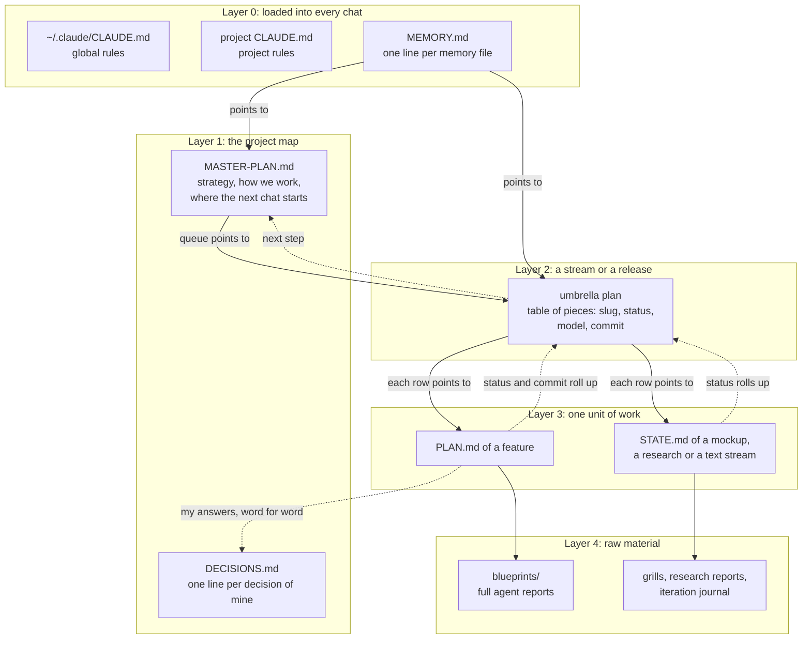

# Checkpoints: how work survives between chats

Every chat ends. The context fills up, Claude Code compacts it, I switch to a cheaper model, or I simply close the laptop. What the next chat knows is only what was written to files. This document is the scheme I use so that every chat ends with a checkpoint, and the checkpoints add up to one picture of where each project stands.

It is also the main way I save tokens. A fresh chat that reads one 150-line state file is far cheaper than a long chat dragging three hours of history into every turn, and it works better: a model with a long, noisy context loses early decisions and follows the latest noise.

## The short version

1. Chat is disposable, files are not.
2. Each unit of work has one state file that a new chat can start from without reading anything else.
3. Each fact lives in one place. Other files link to it.
4. Every chat ends by writing its state down, rolling the status one level up, and saying in one line where to continue and on which model.

## Five layers of files



### Layer 0: what every chat loads before my first message

| File | What is in it | Size I aim for |
|---|---|---|
| `~/.claude/CLAUDE.md` | Mine holds rules for every project (the block this setup installs is a subset): deployment safety, "anything bigger than a typo goes through `/feature-dev`", which model plans and which builds, "local first, then staging", how to report when a request came from a messenger | ~60 lines |
| project `CLAUDE.md` | What is special about this repository: where the methodology lives, where outputs go | a few lines |
| `MEMORY.md` | One line per memory file: corrections I gave, decisions, tool gotchas, pointers to running projects. The model opens a file only when its line looks relevant | one line per file |
| skill and agent list | Names and descriptions only. The full skill text loads when it is used | automatic |

Everything in this layer is paid for in every turn of every chat. That is why rules go here and status does not.

### Layer 1: the project map

- **`MASTER-PLAN.md`.** Why the project exists, what goes in what order, and a section 0 "How we work": where each kind of file lives, how commits happen, and a subsection "Where the next chat starts" with the current queue. A new chat on the project reads section 0 and nothing else of it unless the task needs it.
- **`DECISIONS.md`.** One line per decision I made, newest on top, with a link to where it is worked out. Any "yes", "no" or "redo it" I say in a chat goes here in the same chat. A cancelled decision is not deleted; it gets marked, so the history of why stays.
- Rule files for one kind of work, for example a copywriting guide. One guide per topic, so new rules are added to it instead of growing a parallel set.

### Layer 2: the umbrella plan of a stream

When a release or a stream has several pieces, one file holds them all as a table:

| # | Slug | What | Status | Model | Commit |
|---|---|---|---|---|---|
| 1 | `booking-form` | Move the approved mockup into the code | done | building | `4f2a9c1` |
| 2 | `pricing-copy` | Pricing page texts | plan written, phase-4-done | planning | |
| 3 | ~~`live-chat`~~ | Dropped by my decision | | | |

Below the table: risks, how the whole release is accepted, my answers to the open questions word for word, and a section "For the agent who takes the next piece".

### Layer 3: the state file of one unit

There are two kinds, and both obey the same rule: **a new chat reads this one file and can continue.**

- **`PLAN.md` of a feature**, in `<repo>/.claude/feature-dev/<slug>/`. Seven sections with `Status`, `Scale` and `Model log` lines on top. Format in [`examples/PLAN.example.md`](../examples/PLAN.example.md), lifecycle in [feature-dev.md](feature-dev.md).
- **`STATE.md` of everything else**: a mockup that goes through twenty iterations, a research, a stream of texts. It opens with "This file is self-contained: read it, then look at the live page; do not reread the history, it is in the journal." Then: where everything is (paths, ports, how to restart the server), what the thing looks like now, what is decided, what is open, what to do next. Template in [`examples/STATE.example.md`](../examples/STATE.example.md).

A state file describes the present, not the history. The history goes into the journal next to it.

### Layer 4: raw material

Full reports of explorer, architect and reviewer agents in `blueprints/` with a README saying what was taken from each. Grill sessions, research reports, the iteration journal of a mockup. Nobody reads these by default. They exist so that when a later chat doubts a conclusion, it can open what the conclusion was based on instead of redoing the research.

## How the files talk to each other

Links go **down** when a chat starts and status goes **up** when a chat ends.

**Down, at the start.** The memory line of a project says which file to start from. Section 0 of the master plan points to the umbrella plan. The row in the umbrella plan points to the unit's `PLAN.md` or `STATE.md`. The new chat follows that chain and reads three short things instead of the whole project.

**Up, at the end.** When a unit finishes or stops:

1. its own state file gets the final status;
2. the row in the umbrella plan gets the status, the model that did it and the commit;
3. my decisions from the chat go into `DECISIONS.md`;
4. the queue in section 0 of the master plan moves;
5. the memory line of the project is updated to point at the right file.

**One fact, one place.** The decision text lives in `DECISIONS.md` and the plan where it is worked out. Memory holds a pointer and a one-word status, not a copy. Two live copies of the same text drift apart within a week, and then the next chat has to guess which one is true.

## The checkpoint: how every chat ends

A checkpoint happens on any of these:

- the plan is ready and building should move to the cheaper model, or building hit a problem that needs the planning model back;
- I say "continue tomorrow" or "I need the full context saved";
- Claude Code warns about context or compacts it;
- a unit of work is finished.

At a checkpoint the agent does, in this order:

1. **Writes the unit's state file** so it is self-contained. On a feature: all sections up to the current phase, `Status` updated.
2. **Saves raw material.** Every agent report of this step goes to `blueprints/` as delivered. A summary is not enough: the details it drops are exactly the ones the next chat needs.
3. **Records my words verbatim.** Answers into section 3 of the plan, decisions into `DECISIONS.md`.
4. **Rolls status up**: umbrella row, master plan queue, memory pointer.
5. **Proposes a commit message.** I commit myself; the installed rules say "commit only if the user asks".
6. **Says one line in the chat** if a model switch is needed, always the same shape.
7. **Ends with the context number**: the latest `Context:` line from the hook, the same number written into the state file's `Model log`.

```
I have reached the point where we need to switch to opus.
State saved: .claude/feature-dev/booking-form/PLAN.md
To continue: /model opus, then "continue" (or in a new chat: /feature-dev resume <path>).
Context: 180k / 1M (18%)
```

Then it stops. It does not start building on the planning model "to save a step".

## Models: plan on the strong one, build on the cheaper one

| Work | Model |
|---|---|
| Understanding code, questions, choosing an approach, sorting out a plan that failed | planning model |
| Building by a ready plan, fixes after review, routine edits across many files | building model |
| Explorer and reviewer agents, code search | whatever the agent files say |

I use Fable to plan and Opus to build; you set your own two names (see "Setting it up here"). Before each stage the agent checks its own model, which is named in the system prompt. Wrong model: it does nothing, writes the state, prints the line above. Two exceptions: the user said "do it on this model", or the task is small (scale S), which never stops: its plan is a few lines with nothing to choose.

Why this split: on a fixed subscription, half of the weekly limit of the strongest model used to go in two days, because the planning model also typed all the code. Opus alone did not plan deeply enough for me; Fable for everything was too expensive.

When I leave and say "carry on yourself", I use a second, private version of the skill that does not stop: the chat hands each phase to an agent on the right model. It is not part of this setup; here the switch is always yours.

## How the scheme grew

Each rule came from a specific leak, not from a design session.

| When | What leaked | Rule that came out of it |
|---|---|---|
| Sep 22 | Half the weekly limit of the strongest model in two days | Plan on Fable, build on Opus, a fixed stop line between them |
| Sep 23 | A stop to switch models in front of a step with nothing to decide | No stop when there is no choice of approach |
| Sep 25 | Architect blueprints lived only in chat; the plan referred to lists nobody could see | Full reports go to `blueprints/` at every checkpoint |
| Sep 26 | I wanted to walk away and let it run | A variant that switches models through agents instead of stopping |
| Oct 7 | Three architects on every small change, 100 to 220 KB of reports, the second and third adding a few borrowings | Phase 0 sizes the task S / M / L; a small task gets no agents |
| Oct 10 | The planning model read 200 KB of reports to write a decision of 30 lines | Each report opens with a 40-line "Decision" header; the planner reads only headers; the builder expands the chosen report |
| Oct 15 | A full site check, minutes of CPU, after a two-line text edit | Checks sized to the change; the full run once at the end |
| Oct 16 | No idea how full the context was when a checkpoint hit; the model cannot run `/context` | A hook adds `Context: Nk / 1M` to every message; each checkpoint prints it and writes it into the `Model log` |

## Where it still leaks, and the target

What I would change next, in order of expected effect:

1. **A new chat after every checkpoint, not "continue" in the same one.** Continuing in the old chat drags the whole planning history into every build turn. The state file is already self-contained, so `/clear` and `resume <path>` lose nothing.
2. **Memory holds pointers, not status logs.** Lines in `MEMORY.md` tend to grow into a running log with dates and commit hashes, and that index is paid for in every turn. Target: one line per topic with a pointer; status lives in the state file.
3. **One checkpoint block for every kind of work.** `STATE.md` ends with a checkpoint block (status, decided, open, next step, model); a feature `PLAN.md` spreads the same facts over its sections. Target: the same closing block in both.
4. **Auto mode by default for medium tasks.** Keep the manual stop only for large ones, where I really choose between approaches.

Done since: **measure, do not guess.** Every checkpoint writes the context size into the plan's `Model log`, so after a few weeks there are real numbers per phase, not just "the limit lasts longer".

## Setting it up here

`install.sh` (see the README) puts three things in place:

- **The rules block** in `~/.claude/CLAUDE.md`: the checkpoint steps, the stop line, the context line, the memory rule. It is loaded in every turn, so it stays short.
- **The models block** in the same file, written once and never replaced by `--update`:

  ```
  <!-- claude-code-setup:models:start -->
  Planning model: opus
  Building model: sonnet
  <!-- claude-code-setup:models:end -->
  ```

  Use the names you type after `/model`. `<set me>` means the agent asks you once and fills it in. The same name twice means no model stops; checkpoints still happen.
- **The context hook**, `~/.claude/scripts/claude-code-setup-context-hook.py`, registered as a `UserPromptSubmit` hook in `~/.claude/settings.json`. On every message it reads the token usage of the last answer from this session's transcript and prints one line, which Claude Code adds to the model's context. Window size: `CLAUDE_CONTEXT_WINDOW` at install time if you set it; otherwise 200k, switching to 1M once the context is past 200k. Run `/context` once to see your real window.

Where the number shows:

| Where you work | The model sees `Context:` (hook) | Status line under the prompt |
|---|---|---|
| Terminal | yes | yes, with `scripts/statusline.py` |
| VS Code panel | yes | no, the panel does not render it |
| Desktop app | yes | it shows its own context meter |
| claude.ai/code in a browser | yes, if hooks run in that environment | no |

The status line is optional and not installed, because `statusLine` is a single setting and would replace yours. To add it: `"statusLine": {"type": "command", "command": "python3 /path/to/statusline.py"}` in `~/.claude/settings.json`. It costs no tokens; the model never sees it.

## One source of truth per rule

| Rule | Lives in | Others do |
|---|---|---|
| Names of the planning and building model | The models block in `~/.claude/CLAUDE.md` | The skill and the docs say "the planning model"; they never name one |
| When the feature pipeline stops and the exact stop line | `skills/feature-dev/SKILL.md` | The rules block repeats the line once, for work outside features |
| Checkpoint steps | The rules block, because they apply to every chat | The skill adds only the feature specifics; this document explains why |
| Printing the context number and writing it to the `Model log` | The rules block | The hook only produces the number |
| What a state file contains | `examples/*.example.md` | Rules and docs link to them, they do not repeat the format |
| Memory format and the correction loop | `docs/memory-and-self-learning.md` | The rules block has one line that triggers it |

## See also

- [feature-dev.md](feature-dev.md): the feature pipeline and the numbers behind the scale check.
- [memory-and-self-learning.md](memory-and-self-learning.md): the memory folder in detail.
- [`examples/PLAN.example.md`](../examples/PLAN.example.md) and [`examples/STATE.example.md`](../examples/STATE.example.md): the two state file formats.
